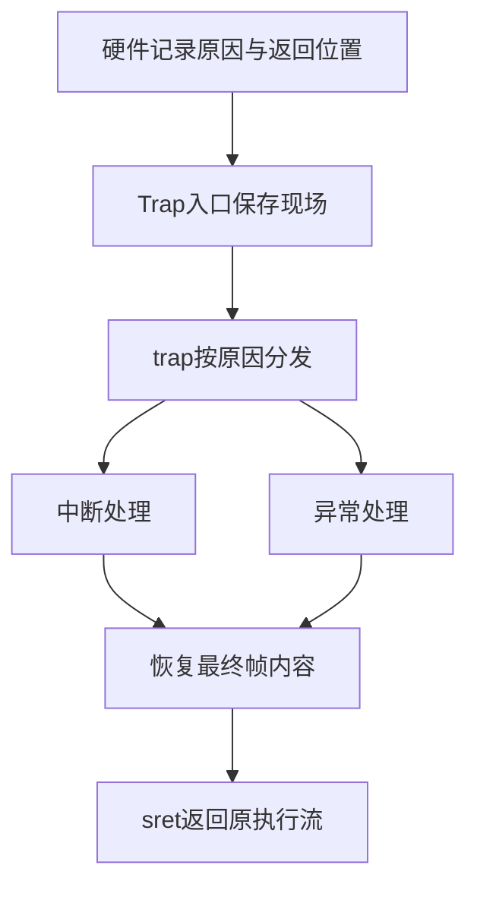

# Lab3 RISC-V 中断与异常处理实验报告

本包后续审查说明：内核源码保持lab3_2511057(2).zip不变，自编验证工具已修订，详见[优化与健壮性记录](../code/docs/OPTIMIZATION.md)。本报告下述目标机结果是输入版本已有记录；本次新增工具仅完成静态和宿主检查，尚待WSL复验，不能把旧成绩当作新版工具的重新运行结果。

## 实验基本信息

| 项目 | 内容 |
|---|---|
| **实验名称** | Lab3：断，都可以断——RISC-V中断与异常处理 |
| **小组成员** | 2511057-祝安毅、2511955-洪亮、2511565-闻鹏杰 |
| **文档更新日期** | 2026-11-05；目标机复验及最终提交尚待完成 |
| **交付内容** | `code/`、`report/report.md`、`report/prompt.md`、`report/images/`，另附完整日志和讲解 |
| **本次提交状态** | 本地文件已整理，Git仓库提交待完成 |

### 小组分工

| 成员 | 练习分工 | 报告分工 |
|---|---|---|
| 2511057-祝安毅 | 复核 Trap 入口、TrapFrame 布局和寄存器恢复。 | 撰写模块一，说明现场如何保存、传给 C 函数并恢复。 |
| 2511955-洪亮 | 复核时钟中断、断点和非法指令的处理。 | 撰写模块二，说明事件如何分类、时钟如何续设，以及异常后从哪里继续执行。 |
| 2511565-闻鹏杰 | 复核 Lab2 内存管理代码的迁移，并核对编译和回归测试记录。 | 撰写 Lab2 衔接和测试结果两部分。 |

每人整理自己负责的部分，合稿后互相核对代码和报告中的描述。代码来源见 [AUTHORS.md](../code/AUTHORS.md)。

---

## 一、实验目的

1. 理解RISC-V的Trap机制，区分同步异常与异步中断，掌握`stvec`、`sepc`、`scause`、`stval`、`sstatus`、`sie`的作用。
2. 理解硬件保存的Trap状态与软件保存的通用寄存器各自负责什么，掌握`TrapFrame`在内核栈上的布局。
3. 补全汇编Trap入口与上下文恢复，让C语言处理函数能够处理事件，并安全返回原执行流。
4. 通过断点、非法指令和持续时钟中断验证返回机制，理解时钟事件续设、计数、统计和关机。
5. 按四段式提示词描述接口、前置条件、后置条件与边界场景，以真实编译、官方评分和目标运行检查AI生成结果。


**指导书实验目的与验证的对应关系：**

| 指导书目标 | 本实验中的落实 | 对应验证 |
|---|---|---|
| 理解RISC-V中断机制 | 结合stvec入口、scause分类、sepc返回位置与sstatus状态分析硬件和软件的分工 | 第二、三、四节的寄存器与执行流说明 |
| 掌握上下文保存与恢复 | 沿用SAVE_ALL，按同一TrapFrame布局实现RESTORE_ALL及C调用接口 | 官方上下文测试、全部可写GPR与SIE恢复检查 |
| 处理断点和时钟事件 | 断点按实际长度跳过；时钟续设、累计计数、统计、定次关机 | 16/32位断点检查、持续时钟评分、正常1000次中断关机 |

非法指令处理是练习页进一步明确要求的功能，也在本次实现与验证中覆盖。

## 二、实验环境

| 项目 | 基线目标运行环境（来自附件记录，不是本轮助手环境） |
|---|---|
| 宿主环境 | Windows，Ubuntu WSL2，单核QEMU实验 |
| Linux | Ubuntu 26.04.1 LTS，WSL内核6.6.114.1 |
| 交叉编译器 | SiFive RISC-V GCC-Metal 10.2.0-2020.12.8 |
| 模拟器/固件 | QEMU 4.1.1，`virt`机器，默认OpenSBI v0.4，SBI 0.1接口 |
| 构建工具 | GNU Make 4.4.1；Python3版本及完整工具输出见环境日志 |
| 目标架构 | RV64，支持压缩指令；Sv39内核高地址映射；默认128MiB RAM |
| 主要编译选项 | 框架原有`-O2 -Wall -Werror -mcmodel=medany -nostdinc`等 |
| 框架来源 | 本地`RISC-V/labcodes/lab3/lab3_new` |
| 报告模板 | `实验报告模板.md` |

完整环境输出：[01-environment.log](./logs/01-environment.log)。

| 成员 | AI 编程工具 | 底层模型 | 备注 |
|---|---|---|---|
| 2511057-祝安毅 | Codex | GPT-6.1-Sol | |
| 2511955-洪亮 | DeepSeek | 版本未记录 | |
| 2511565-闻鹏杰 | Codex（ChatGPT） | gpt-6.1-sol | 用于复查验证脚本和测试记录。 |

本轮可运行宿主工具包括GCC 13.3.0和Python；未找到RISC-V交叉工具链及QEMU。两类环境不混写，本轮原始记录见[宿主回归日志](../code/validation/assistant-tests/final-regression.log)。


## 三、实验整体逻辑分析

### 3.1 本章节的逻辑主线

本实验围绕“突发事件发生以后，内核如何处理并继续原程序”展开。只有产生Trap而不能恢复上下文，系统仍不能正常工作；本章要形成完整闭环：硬件记录部分状态，汇编保存完整现场，C语言分类处理，汇编恢复现场，最后由`sret`返回。



### 3.2 功能的逐步实现

1. **补全Lab2依赖**：先有可工作的物理页描述符与分配器，`pmm_init`才能通过自检并继续启动；迁移时保留Lab3新加入的本核中断保护。
2. **确认保存布局**：给定的`SAVE_ALL`与`struct trapframe`是统一契约，恢复逻辑必须以它们为依据。
3. **打通入口和返回**：`__alltraps`把栈上的帧地址作为a0传给`trap`；C函数返回后，`RESTORE_ALL`恢复上下文，`sret`完成特权状态返回。
4. **实现异常和中断分支**：同步异常根据指令长度更新epc；异步时钟中断保留epc，安排下一次事件并累计计数。
5. **验证完整行为**：官方评分检查规定功能，正常启动检查1000次中断后关机，额外测试覆盖16/32位指令和中断状态恢复。

顺序的原因是：业务处理依赖正确的帧和返回流程；一次能返回也不代表能持续处理中断，必须进一步验证周期性运行。

## 四、实验内容与实现

### 前置任务：迁入实验二实现

**来源与责任：** 本节是继承代码的迁移分析；闻鹏杰本轮核对边界和中断保护，历史个人实现分工待小组确认，不改写原署名。

**函数与接口：**

```c
static void page_init(void);
static void best_fit_init(void);
static void best_fit_init_memmap(struct Page *base, size_t n);
static struct Page *best_fit_alloc_pages(size_t n);
static void best_fit_free_pages(struct Page *base, size_t n);
static size_t best_fit_nr_free_pages(void);
```

`page_init`从DTB获取内存范围，建立Page数组，保留固件、内核和描述符占用，再把剩余完整页交给分配器。`npage`是物理页号上界，Page描述符数是`npage-nbase`，不能把两个数混淆。

Best-Fit的空闲块链表按地址排列；分配寻找最小的足够块，精确匹配可立即结束搜索；释放时与前后相邻块合并。当前Lab3框架默认选择First-Fit，本次保留这一选择；迁入的Best-Fit在独立扩展副本中被选中并通过其原始自检。

**适配细节：** 旧Lab2实现使用`PHYSICAL_MEMORY_END`和`KERNEL_BEGIN_PADDR`，Lab3头文件没有这两个宏。本次在迁入代码内改用已有的`PADDR(KERNTOP)`和`PADDR(KERNBASE)`，保留原头文件。`alloc_pages`等函数中的`local_intr_save/restore`也保持原样，没有用旧Lab2的无中断保护包装器覆盖Lab3版本。

**spec与Prompt的设计依据：** 先把“BSS和DTB已初始化”写为前置条件，把“所有占用区域被保留、只注册完整空闲页”写为后置条件；再以合法范围、空间不足或地址溢出划分情况。Best-Fit的规格以链表有序、块长度与空闲计数一致为不变量，覆盖精确匹配、分裂、失败及前后合并。Prompt的RELY只列Lab3真实存在的宏和接口，明确旧Lab2边界宏的适配，防止覆盖Lab3新增的中断保护。

**最终提示词与spec：**

```text
[PROMPT]
任务：补齐实验三依赖的实验二内存管理代码。
将实验二的 page_init 和 Best-Fit 实现迁入 kern/mm/pmm.c、
kern/mm/best_fit_pmm.c 中的 lab2 标记处，按实验三现有接口完成适配。
保留实验三的初始化顺序、中断保护和原有检查函数。需要新增的辅助函数
放在对应文件内，设为 static。完成后说明接口适配处，并检查编译和内存自检。

[RELY]
1. dtb_init 已在 page_init 前执行，可通过 get_memory_base()、
   get_memory_size() 取得物理内存范围。
2. 页大小为 PGSIZE。pages 指向 Page 描述符数组；nbase 是内存起始页号；
   npage 是管理范围的物理页号上界，描述符数量为 npage - nbase。
3. PADDR、KERNBASE、KERNTOP、PHYSICAL_MEMORY_OFFSET 以实验三头文件为准。
   实验三未定义的实验二边界宏，应使用已有地址关系适配，不改动头文件。
4. 空闲块用 free_area_t 和 Page.page_link 管理，块首页的 property 记录块长。
   PageReserved、PageProperty、set_page_ref 和链表操作接口均已提供。
5. alloc_pages、free_pages、nr_free_pages 已带本核中断保存与恢复逻辑。

[GUARANTEE]
补齐或迁入以下实现，保持原有函数签名：
static void page_init(void);
static void best_fit_init(void);
static void best_fit_init_memmap(struct Page *base, size_t n);
static struct Page *best_fit_alloc_pages(size_t n);
static void best_fit_free_pages(struct Page *base, size_t n);
static size_t best_fit_nr_free_pages(void);
const struct pmm_manager best_fit_pmm_manager;

[SPECIFICATION]
page_init
Pre-Condition：DTB已解析，内核映射已建立，BSS已清零。
Post-Condition：Page数组与物理页的对应关系正确；固件、内核、描述符数组及
对齐间隙保持保留；只有管理范围内剩余的完整页进入空闲链表。
Case 1：内存范围有效时，先确定DTB范围与内核映射范围的交集，再检查
描述符所需空间，完成各页初始化和空闲区登记。
Case 2：基址不支持、地址计算溢出或描述符空间不足时，通过现有panic报错，
不能越界写入Page数组。

best_fit_init
Pre-Condition：开始初始化Best-Fit管理器，尚未登记空闲区间。
Post-Condition：空闲链表初始化为空，空闲页计数置0。

best_fit_init_memmap
Pre-Condition：管理器已初始化，base指向有效Page区间，n大于0，
区间内各页处于待登记的保留状态。
Post-Condition：给定页转为空闲状态，块首页记录正确长度，空闲计数增加n；
链表按地址有序，物理相邻的空闲区间可以合并。

best_fit_alloc_pages
Pre-Condition：空闲链表与计数一致，请求n大于0。
Post-Condition：成功时返回最小的足够连续块，必要时保留剩余部分；失败时
返回NULL，链表和计数不变。
Case 1：存在精确匹配块，直接使用该块。
Case 2：只有更大的块，从其中最小的块分配；等大时选地址较低者。
Case 3：总空闲页不足或没有足够连续块，返回NULL。

best_fit_free_pages
Pre-Condition：base是已分配区间的起点，n大于0，区间有效。
Post-Condition：归还区间按地址放回链表，与前后物理相邻的空闲块合并，
空闲计数只增加n一次。

best_fit_nr_free_pages
Pre-Condition：管理器已初始化，空闲链表与计数一致。
Post-Condition：返回当前空闲页总数，不改变管理状态。

Requirements：保留basic_check、best_fit_check以及实验三的分配器选择；
不得用旧实验的包装函数覆盖本次已有的中断保护。
```

**基线附件中的验证结果：** 日志记载迁入后编译成功，正常启动显示DTB范围`[0x80000000,0x88000000)`，管理32768个描述符，初始空闲31928页；内存自检输出`check_alloc_page() succeeded!`。这些数字来自基线镜像与默认128MiB配置，并非本轮重新启动取得，镜像大小改变后空闲页数可能变化。

### 功能模块一：Trap上下文恢复与Trap入口

**来源与责任：** 实现区保留2511057署名；建议祝安毅负责该模块的讲解与复核，实际完成情况由小组确认。

**需要实现的汇编功能：** `RESTORE_ALL`、`__alltraps`。C语言接口保持：

```c
void trap(struct trapframe *tf);
```

#### 1. 布局与功能理解

RV64中一个`uintptr_t`为8字节，帧共有36个槽位，总计288字节。

| 槽位 | 字节偏移 | 含义 |
|---|---:|---|
| 0..31 | 0..248 | x0..x31；槽位2保存Trap前的sp |
| 32 | 256 | sstatus |
| 33 | 264 | sepc |
| 34 | 272 | stval快照，框架旧名称为badvaddr |
| 35 | 280 | scause |

`SAVE_ALL`先将原sp写入`sscratch`，再令sp减288分配帧。因此恢复时要一直以当前sp为帧基址，最后才从槽位2恢复原sp。288是16的倍数，保持调用C函数需要的栈对齐。

`__alltraps`在保存后执行`mv a0, sp; jal trap`。a0是RISC-V ABI的第一个参数寄存器，原a0与ra已经保存，因此可以用于传参和调用。

`RESTORE_ALL`先从帧中取出`sstatus`和可能被C处理修改的`sepc`，写回CSR；再恢复通用寄存器，最后恢复sp。`scause`和`stval`在此作为诊断快照，不需要写回。x0不可写，无需恢复。

本实验Trap发生在S态，保存的SPP为1，因此`sret`返回S态。不能把“执行sret”说成“一定从内核态返回用户态”；返回哪个特权级由SPP决定。源码中历史注释提到`iret`，实际执行的是RISC-V的`sret`，本次保持保护函数原文不改。

#### 2. 最终提示词与spec

**为什么这样写：** RESTORE_ALL的输入不是普通参数，而是sp指向的一份既定布局，因此前置条件明确“sp指向SAVE_ALL生成的帧”。后置条件描述通用寄存器、CSR与原sp的恢复结果；两个Case区分epc保持和epc被C处理修改，确保返回位置采用最终帧值。__alltraps的规格则约束a0传参、栈对齐和C返回后的sp。把SAVE_ALL、帧结构与函数签名列为禁止修改项，是为了让保存、解释和恢复始终使用同一个契约，而不是通过修改框架迁就生成的代码。


```text
[PROMPT]
任务：完成实验三模块一的Trap入口和上下文恢复。
在 kern/trap/trapentry.S 的 lab3 function1 标记处补全 RESTORE_ALL
和 __alltraps，使保存后的现场能够传给 trap()，处理完成后恢复并返回。
保留lab3注释，将YOUR CODE替换为2511057。不要修改SAVE_ALL、
struct trapframe、trap()的签名以及其他已有代码。

[RELY]
1. 目标为RV64，REGBYTES为8。SAVE_ALL已在内核栈上建立TrapFrame，
   共36个寄存器槽位，大小为288字节。
2. 槽位0至31对应x0至x31；槽位32、33、34、35分别对应
   sstatus、sepc、stval和scause。结构体中的字段名为
   gpr、status、epc、badvaddr、cause。
3. SAVE_ALL分配帧之前将原sp暂存于sscratch，之后把原sp写入槽位2，
   并将sscratch清零。因此槽位2保存的是Trap前的栈顶。
4. C接口为 void trap(struct trapframe *tf)。RISC-V调用约定用a0传递
   第一个参数，C函数返回时应保持调用前的sp。
5. __trapret中已有RESTORE_ALL和sret；sret使用sepc决定返回地址，
   结合sstatus中的SPP、SPIE完成特权级与中断状态返回。

[GUARANTEE]
实现汇编宏 RESTORE_ALL。
补全入口标签 __alltraps 中从保存现场到调用trap()的部分。
现有符号和TrapFrame布局保持不变。

[SPECIFICATION]
RESTORE_ALL
Pre-Condition：sp指向SAVE_ALL建立的有效TrapFrame，C处理函数已经返回。
Post-Condition：恢复所有可写通用寄存器，原sp恢复；sstatus、sepc采用
帧中的最终值，随后能够执行sret。
Case 1：C处理没有改变epc，返回到帧中原有的执行位置。
Case 2：C处理修改了epc，返回到更新后的位置，不能恢复成修改前的地址。
Requirements：恢复所需临时寄存器不能破坏已经恢复的原值；sp最后从
槽位2恢复，保证此前各次加载使用同一帧基址。x0无需恢复，scause和stval
作为诊断信息保留在帧中，无需写回。保留帧中的SPP，不强制切换到用户态。

__alltraps
Pre-Condition：处理器已跳转到Trap入口，当前内核栈可用于保存现场。
Post-Condition：先通过SAVE_ALL保存现场，再将该帧地址按调用约定传给trap；
trap返回后，执行进入__trapret，使用同一份帧恢复现场。
Requirements：传递帧指针即可，不复制整个结构体；调用C函数时保持16字节
栈对齐；原a0和ra必须在调用前已经保存。整个入口、处理和返回过程中，
通用寄存器的原值应保留，只有处理函数明确修改的帧字段按修改后值恢复。
```

#### 3. 关键代码与完整源码

```asm
mv a0, sp
jal trap
```

恢复的最后一步为：

```asm
LOAD x2, 2*REGBYTES(sp)
```

完整`trapentry.S`在附录A逐行给出，其中`SAVE_ALL`与原框架一致，所有`lab3`注释保留并填入学号2511057。

#### 4. 实际迭代与结果

第一次实现依据既有帧布局补全，随后官方35分上下文/断点测试通过。扩展测试进一步验证全部31个可写GPR，包括a0、ra、sp、gp、tp；显式的16位`c.ebreak`与位于半字边界的32位`ebreak`都能返回。该模块首次补全后通过了上下文与断点测试，后续检查重点放在寄存器原值和中断状态是否正确恢复。

### 功能模块二：中断与异常处理

**来源与责任：** 实现区保留2511057署名；建议洪亮负责该模块的讲解与复核，不据此改署历史代码。

**需要实现的函数：**

```c
void interrupt_handler(struct trapframe *tf);
void exception_handler(struct trapframe *tf);
```

#### 1. 中断分类与时钟处理

`trap_dispatch`根据`scause`最高位区分中断与异常，处理器为RV64时最高位是bit63。`interrupt_handler`去掉这一位后检查原因码，S态时钟原因码为5。

正常时钟分支先调用`clock_set_next_event`安排下一事件，再将`ticks`增加1。在100的整数倍调用原有`print_ticks`，累计打印达到`SHUTDOWN_AFTER`时调用`sbi_shutdown`。

本地源码只有`TICK_NUM=100`，没有网页提到的`SHUTDOWN_AFTER`；网页也没有给出具体数值。本次在允许填充区域内补充可覆盖的默认值10，含义是“打印十次”，也就是累计1000次时钟中断。该值是实现采用的明确配置，不写成指导书指定数字。

QEMU中time计数频率为10MHz，`clock.c`间隔100000个time单位，对应约10ms、每秒约100次。OpenSBI设置一次事件并不等于永久周期触发，必须在处理时再次设定。`ticks`不清零，所以打印十行`100 ticks`表示十个统计区间。

其他中断按框架列出的软件、时钟、外部原因输出名称；未知中断输出`Unknown interrupt: cause N`并打印完整帧。框架头文件中包含旧版H态等原因名，本实现按框架区分，不把这些名称解释为目标机已经实现所有相应设备。

#### 2. 异常分类与epc更新

| 异常 | 原因码 | 输出 | 返回处理 |
|---|---:|---|---|
| 非法指令 | 2 | `Exception type: Illegal instruction`和`Illegal instruction at 0x...` | 首半字判断16/32位，epc加2/4 |
| 断点 | 3 | `Exception type: Breakpoint`和`Breakpoint at 0x...` | 同样按实际长度加2/4 |
| 其他异常 | 其他 | 原有`print_trapframe(tf)` | 不擅自更改epc，不声称已恢复未知故障 |

首半字最低两位非11表示16位指令，本实验普通32位编码最低两位为11。使用`uint16_t`读取避免假定32位指令地址必然四字节对齐。本次读取对象是已有内核映射中的可读指令；没有实现用户地址安全取指、缺页恢复和48位及以上编码跳过。

同步异常如果不移动epc，会反复执行同一异常指令；但时钟中断是异步事件，不能给epc随意加4，否则会跳过正常工作。

#### 3. 最终提示词与spec

**为什么这样写：** 中断handler按S态时钟、其他已知原因、未知原因划分Case；后置条件同时要求下一事件已设定、计数恰增一次、统计和关机条件正确。异常handler按非法指令、断点、其他异常划分Case；把epc可读写入前置条件，并按16/32位编码更新位置。规格约束输出内容、状态变化和返回位置。两个支持的异常共用长度解码；其他异常只打印现场并返回，避免进入公共epc更新流程。


```text
[PROMPT]
任务：完成实验三模块二的中断与异常分类处理。
在 kern/trap/trap.c 的 lab3 function2 标记处实现 interrupt_handler
和 exception_handler，保留原函数签名、分发流程和其他已有函数。
保留lab3注释，将YOUR CODE替换为2511057。需要的头文件、局部静态状态
和参数定义放在该实现区域。完成后检查持续时钟、异常返回与未知原因分支。

[RELY]
1. struct trapframe中的cause是scause快照，epc记录返回位置。
   RV64下cause最高位为中断标志，剩余部分为原因号。
2. IRQ_S_TIMER表示S态时钟中断；CAUSE_ILLEGAL_INSTRUCTION和
   CAUSE_BREAKPOINT分别表示非法指令异常和断点异常。
3. ticks在clock_init中初始化为0，类型为volatile size_t。
   clock_set_next_event()只设置一次未来事件；TICK_NUM为100；
   print_ticks()已提供，按课程格式输出100 ticks。
4. print_trapframe(tf)用于输出完整现场，sbi_shutdown()声明于sbi.h。
5. 指导书要求使用SHUTDOWN_AFTER控制统计次数。本地框架未定义该值，
   本次设默认值10，允许编译时覆盖；它表示统计输出次数，不是单次中断数。
6. 本次处理已映射内核代码中的16位和32位异常指令。首半字最低两位
   不为11时是16位编码，普通32位编码最低两位为11。

[GUARANTEE]
void interrupt_handler(struct trapframe *tf);
void exception_handler(struct trapframe *tf);
不得修改print_ticks、idt_init、trap_dispatch、trap及课程测试代码。

[SPECIFICATION]
interrupt_handler
Pre-Condition：tf指向有效TrapFrame，当前事件已由分发器判定为中断。
Post-Condition：完成当前类型对应的处理，保持epc不变；未关机时能够
进入统一返回流程。
Case 1：S态时钟中断，重新设置下一次事件，ticks恰好增加1；达到
TICK_NUM的整数倍时调用print_ticks。统计输出累计达到SHUTDOWN_AFTER
次时调用sbi_shutdown。
Case 2：框架列出的其他软件、时钟和外部中断，输出相应类型提示。
Case 3：未知中断，输出Unknown interrupt: cause N，再打印完整TrapFrame。
Requirements：去掉中断标志位后再识别原因号；每次时钟均需续设事件；
正常时钟路径不分配动态内存，控制台统计输出仅发生在规定的计数点。

exception_handler
Pre-Condition：tf有效；对于要跳过的非法指令和断点，epc指向可读的
16位或32位内核指令。
Post-Condition：支持的异常输出类型和修改前的地址，并把epc移动到下一条
指令；其他异常只输出完整现场，epc不变。
Case 1：非法指令异常，依次输出
  Exception type: Illegal instruction
  Illegal instruction at 0x...
根据实际指令长度使epc增加2或4。
Case 2：断点异常，依次输出
  Exception type: Breakpoint
  Breakpoint at 0x...
同样按实际长度使epc增加2或4，不能只根据异常类型固定偏移量。
Case 3：其他异常，调用print_trapframe后返回，不进入支持异常的epc更新流程。
Requirements：通过首半字判断本次支持的指令长度，不要求指令地址四字节
对齐；公共的长度判断只保留一处，每次异常只更新epc一次。
```

#### 4. 最终实现代码

以下代码从实际最终源文件提取；`print_ticks`、`idt_init`、`trap_dispatch`、`trap`等原有函数均保持原样。

```c
//lab3 function2 2511057
#include <sbi.h>

/* The supplied skeleton omits the threshold mentioned by the guide.
 * Default: ten reports (1000 interrupts); override with -DSHUTDOWN_AFTER=N. */
#ifndef SHUTDOWN_AFTER
#define SHUTDOWN_AFTER 10
#endif
#if SHUTDOWN_AFTER < 1
#error SHUTDOWN_AFTER must be positive
#endif

void interrupt_handler(struct trapframe *tf) {
    static size_t reports;
    uintptr_t cause = tf->cause & ~((uintptr_t)1 << (__riscv_xlen - 1));
    /* The timer is the normal hot path: avoid the diagnostic switch table.
     * Keep the incremented value locally to avoid re-reading volatile ticks. */
    if (cause == IRQ_S_TIMER) {
        clock_set_next_event();
        size_t current_ticks = ticks + 1;
        ticks = current_ticks;
        if (current_ticks % TICK_NUM == 0) {
            print_ticks();
            if (++reports >= SHUTDOWN_AFTER) {
                sbi_shutdown();
            }
        }
        return;
    }
    switch (cause) {
        case IRQ_U_SOFT: cprintf("User software interrupt\n"); break;
        case IRQ_S_SOFT: cprintf("Supervisor software interrupt\n"); break;
        case IRQ_H_SOFT: cprintf("Hypervisor software interrupt\n"); break;
        case IRQ_M_SOFT: cprintf("Machine software interrupt\n"); break;
        case IRQ_U_TIMER: cprintf("User timer interrupt\n"); break;
        case IRQ_H_TIMER: cprintf("Hypervisor timer interrupt\n"); break;
        case IRQ_M_TIMER: cprintf("Machine timer interrupt\n"); break;
        case IRQ_U_EXT: cprintf("User external interrupt\n"); break;
        case IRQ_S_EXT: cprintf("Supervisor external interrupt\n"); break;
        case IRQ_H_EXT: cprintf("Hypervisor external interrupt\n"); break;
        case IRQ_M_EXT: cprintf("Machine external interrupt\n"); break;
        default:
            cprintf("Unknown interrupt: cause %lu\n", (unsigned long)cause);
            print_trapframe(tf);
            break;
    }
}

void exception_handler(struct trapframe *tf) {
    switch (tf->cause) {
        case CAUSE_ILLEGAL_INSTRUCTION:
            cprintf("Exception type: Illegal instruction\n"
                    "Illegal instruction at 0x%016lx\n", tf->epc);
            break;
        case CAUSE_BREAKPOINT:
            cprintf("Exception type: Breakpoint\n"
                    "Breakpoint at 0x%016lx\n", tf->epc);
            break;
        default:
            print_trapframe(tf);
            return;
    }
    /* Both supported exceptions share the same 16/32-bit resume rule.
     * A halfword load also accepts a 32-bit instruction aligned to 2 bytes. */
    uintptr_t epc = tf->epc;
    uint16_t first_halfword = *(const volatile uint16_t *)epc;
    tf->epc = epc + ((first_halfword & 3) == 3 ? 4 : 2);
}
```

#### 5. 迭代记录与性能核对

以下1至5项均为输入包继承的实现与回归记录；本轮助手新执行的检查见第七节，不把继承记录改称为本轮新运行。

1. **原始框架缺项**：附件日志记载未实现两个handler时编译触发`implicit declaration`，在`-Werror`下失败。原始日志保留为[00-baseline-build.log](./logs/00-baseline-build.log)。这是待填框架本身未完成，不写成已经发生的“AI生成算法bug”。
2. **首版实现**：完成Lab2依赖、入口恢复、handler及关机参数后，编译、正常关机、官方100/100、6项边界测试均通过。
3. **性能修订**：检查实际反汇编，发现时钟分支经过诊断switch跳转表，且`ticks++`后再读volatile变量会多一次内存读取。最终将常见的S态时钟分支前置，使用局部的递增值判断100的整数倍；每次异常的两行输出合并到一次`cprintf`调用。输出内容、计数条件和返回语义保持一致。
4. **最终回归**：对性能修订后的源码重新执行正常关机、原始`make grade`和边界测试，结果在第五节列出。没有把首版成绩直接当作修订后成绩。

5. **2026-11-05复核优化**：合并非法指令和断点的重复长度解码，使未知异常直接返回；删除Lab2迁移后两边都等于PADDR(KERNTOP)的恒假比较。后者属于源码清理，编译器本就可能消除，不能声称产生了额外运行时收益。相同工具链与-O2下，exception_handler的静态机器指令从49条减少到35条、函数体从136字节缩小到100字节；时钟处理及Trap汇编指令数保持不变。完整比较见[本次优化比较](./logs/review-2026-11-05/performance-comparison.json)。静态函数大小不等于每次运行的周期数。

**问题分类：** 原始框架缺少handler属于待完成项，缺失宏属于接口适配，重复解码和恒假比较属于实现冗余，WSL启动命令的PATH展开问题属于环境调用。首次补全后没有出现目标运行失败，后续改动主要用于接口适配和减少重复逻辑，验证结果见第五节。

**性能依据：**

- 正常时钟处理固定次数的操作，时间和额外空间都是O(1)，没有动态分配、链表遍历或逐次完整帧打印。
- 计数更新每次读取一次并写回一次volatile的`ticks`；统计输出频率为每100次中断一次。
- 使用原有`-O2`构建；反汇编显示统一分发器被内联成原因位判断与尾跳转，异常长度判断使用`lhu`读取首半字。
- 保持`ticks % 100`的准确语义，真实构建仍包含硬件余数指令；不把“去掉所有除法”或“达到最快性能”写成不存在的结果。
- 已知的完整保存布局需要36次存储；恢复31个可写GPR及2个CSR值需要33次加载，均与帧大小无关，为固定开销。
- 迁入Best-Fit为O(F)扫描（F为空闲块数），精确匹配立即返回；有序释放插入O(F)，相邻块合并O(1)。这是教学框架中的实现范围，没有未经验证地改成复杂索引。

优化前后实际反汇编见[优化前](./logs/08-performance-before.log)、[最终版本](./logs/09-performance-final.log)。这里提供复杂度和机器代码依据，没有进行真实硬件微基准，因此不据此估算提速倍数或纳秒延迟。

### 练习相关理解：本核中断保护

`local_intr_save`先记录SIE，必要时关闭本核中断；`local_intr_restore`只在进入前开启的情况下重新开启。嵌套时内层发现本来已经关闭，就不应在退出时提前打开。

宏中的`do { ... } while (0)`让多条语句宏在语法上表现为一条完整语句，能够安全用于`if/else`结构；它不负责提供硬件原子性。本核关中断也不等于多核互斥，其他CPU仍然需要锁来协调。

### Challenge范围核对

2026-11-05重新读取的[练习页](http://oslab.mobisys.top/lab2026/_book/lab3/lab3_2_1_exercise.html)列出Lab2依赖迁移及上述两个功能模块，没有单独列出的必做Challenge。原理说明中介绍了U/S模式的一般机制，但当前框架与验证针对S态内核Trap，不能把原理介绍当作已经实现完整用户态栈切换的证据。

## 五、测试与验证

### 5.1 当前版本的复现命令

以下为待在Ubuntu/WSL执行的步骤，不表示本轮已经执行。进入当前工程的`code/`，先确认实际工具目录；下面路径沿用闻鹏杰历史环境，若不存在应修正，不重装已可用工具。

```bash
export TOOLCHAIN_BIN="$HOME/os-lab/tools/riscv64-unknown-elf-toolchain-10.2.0-2020.12.8-x86_64-linux-ubuntu14/bin"
export QEMU_BIN="$HOME/os-lab/tools/qemu-4.1.1/riscv64-softmmu"
export PATH="$TOOLCHAIN_BIN:$QEMU_BIN:$PATH"
command -v riscv64-unknown-elf-gcc
command -v qemu-system-riscv64
python3 tests/check_integrity.py
python3 tests/check_baseline.py
bash tests/run_required.sh
python3 tests/extended_qemu.py
```

新版`run_required.sh`会在独立副本构建、直接启动同配置QEMU，并调用原始`make grade`，只将`GRADE_TMP`覆写为本轮独立临时路径。QEMU上限30秒，评分上限150秒；超时或退出码非零均失败。命令、工作目录、返回码和输出存于每次新建的`code/validation/required-*`，不覆盖`report/logs`。扩展测试同样使用新日志目录，原测试体不变。脚本每次干净构建，不复用个人工作目录的bin/obj。

预期基础检查出现`REQUIRED PASS`，默认内存自检通过、十行`100 ticks`、SBI正常关机，官方三项合计100/100；扩展出现`EXTENDED PASS`。这些预期尚需闻鹏杰本机输出确认。失败应保留`LOG DIRECTORY`、`summary.json`和第一条关键错误，不把工具缺失或超时当作通过。

### 5.2 输入版本已有目标运行记录

本表来自输入包`lab3_2511057(2).zip`自带的2026-11-05日志，未由本轮助手重新执行。65项源码哈希在前次审查中匹配，本轮另逐字节确认56个课程文件仍与该输入一致；哈希一致不能替代独立运行，也不能单独证明日志的执行过程。旧版记录另存`logs/review-2026-11-05/previous-validation/`。

| 验证项 | 实际结果 | 证据 |
|---|---|---|
| 优化构建 | 成功，无`-Werror`错误 | [03-build.log](./logs/03-build.log) |
| 原始文件保护 | 52个原始文件、6处保护区域一致，学号标记已填写 | [02-integrity.log](./logs/02-integrity.log) |
| 正常启动/默认关机 | 十行`100 ticks`，共1000次中断，`make qemu`返回0 | [04-make-qemu.log](./logs/04-make-qemu.log) |
| 官方上下文/断点 | PASS，35/35 | [05-make-grade.log](./logs/05-make-grade.log) |
| 官方非法指令/兜底 | PASS，25/25 | 同上 |
| 官方持续时钟 | PASS，40/40 | 同上 |
| **官方总分** | **Total Score: 100/100** | 同上 |
| 额外边界运行 | 6项PASS；最后`ticks=250`并关机 | [07-extended-qemu.log](./logs/07-extended-qemu.log) |

`make grade`在课程规定的临时副本注入原始测试，不修改提交源码。评分器会清理临时副本，所以这里保存的是完整`make grade`标准输出；额外测试的完整QEMU原始输出单独保存，并没有把两者混称为同一次运行。

### 5.3 基线六项边界测试与覆盖范围

以下覆盖项来自既有测试源码及附件运行日志；本轮只检查其源码并保持测试体原样，没有声称在当前助手环境重跑QEMU。

1. 全部31个可写GPR，包括sp、ra、a0、gp、tp，在断点返回后保持；SIE原先关闭时仍关闭，sscratch保持内核约定。
2. 显式16位`c.ebreak`和半字对齐的32位`ebreak`均正确返回，排除汇编器自动压缩掩盖问题。
3. 显式16位非法指令`0x0000`和32位非法指令`0x0000007b`均跳到下一指令。
4. 嵌套临界区在进入前关闭中断时，不会错误开启。
5. 开中断后触发断点，异常返回恢复SIE；嵌套临界区的内层不提前开中断、外层正确恢复。
6. 经混合异常后仍可收到250次时钟中断，证明返回流程和后续时钟续设仍可工作。

上述扩展在独立临时副本中执行，还选择Best-Fit运行其原始自检；不会污染官方注入点或交付默认配置。

### 5.4 测试结果图与截图状态

以下四张图片继承自输入附件，其报告说明图片由2026-11-05日志排版生成。它们是**基线日志结果图，不是原生终端截图，也不是本轮新测试截图**。原生编译、运行和评分截图仍需按助教实际要求补充；未取得前不把此项标为完全完成，不用排版图冒充个人运行现场。


### 5.5 交付要求逐项核对

| 要求 | 完成状态与位置 |
|---|---|
| 按Markdown模板写报告 | 本文件保留基本信息、实验目的、环境、逻辑、实现、验证、总结主结构 |
| 所有Lab2占位迁入 | `pmm.c`、`best_fit_pmm.c`标记区域 |
| `RESTORE_ALL`、`__alltraps` | 已实现；`SAVE_ALL`与帧结构未改 |
| 两个handler、续设时钟、2/4字节epc | 已实现；有基线目标日志，本轮宿主逻辑通过；新版验证入口待目标复验 |
| 定次关机 | 默认10次统计输出，配置来源已说明 |
| 保留lab3注释并替换学号 | 已填2511057，核心源码无`YOUR CODE`残留 |
| spec、最终提示词、实际问题与修订 | 第四节、[prompt.md](./prompt.md) |
| OS原理对应与未覆盖知识 | 第六节 |
| 代码、报告、prompt、images | 统一保留code/report结构；另附基线ZIP、安装脚本和补丁供回滚，不冒充额外实验任务 |
| 原生测试截图 | 未取得；已附真实日志结果图、原始输出与复现命令，明确未冒充截图 |
| `lab3`分支及push | 待后续上传至小组仓库的lab3分支 |

### 5.6 指导书七项实验报告要求核对

2026-11-05重新读取指导书的实验目的、实验内容、练习、项目执行流、中断原理、入口、C处理、时钟、中断保护及报告要求，并核对实验报告模板。七项书面内容均已覆盖，重点补强了第4项的设计理由、第5项的问题分类，以及第6项的概念含义。

| 指导书要求 | 对应位置 | 核对结果 |
|---|---|---|
| 1. Markdown格式，以文本说明为主 | 全文；完整代码放在第四节与附录，另有源码目录 | 符合，包含文字分析、规格、解释与真实结果，非只贴代码 |
| 2. 整体逻辑线、功能实现顺序 | 第三节3.1、3.2 | 符合，说明依赖迁移→保存布局→入口/返回→具体处理→验证及顺序原因 |
| 3. 核心函数和模块理解 | 第四节三个任务，含本核中断保护 | 符合，说明接口、帧布局、sp、CSR、调用约定、时钟续设与epc |
| 4. 每个练习spec和prompt怎么写 | 第四节各模块设计依据与完整四段式Prompt；prompt.md集中汇总 | 符合，明确前置条件、后置条件、Case、不变量与修改边界的设计理由 |
| 5. AI生成过程中的bug与解决 | 第四节实际迭代、问题分类；原始编译与验证日志 | 符合，如实区分框架缺项、适配、环境问题和优化；首次实现通过后的记录以实际优化和回归为主 |
| 6. 重要知识点与OS原理的含义、关系、差异 | 第六节6.1 | 符合，逐项说明概念及本实验与完整OS机制的边界 |
| 7. OS原理重要但本实验未覆盖的知识 | 第六节6.2 | 符合，列出调度、用户隔离、缺页、多核、设备I/O与扩展状态 |

**与七项书面要求分开的交付事项：** 代码、报告、完整提示词、图片及学号注释已具备；分工表已区分建议职责和可确认事实，工具表只填本轮已知信息。三人实际贡献、其他成员工具信息、个人WSL复验、原生截图和Git提交仍需确认；不因书面内容齐全就将这些事项标成完成。

## 六、实验总结与收获

### 6.1 对操作系统的理解

| 本实验知识点 | 实验中的含义 | 对应OS原理的含义 | 联系与差别 |
|---|---|---|---|
| TrapFrame与保存/恢复 | 把寄存器及CSR快照存入36个槽位，并按原布局恢复 | 上下文是继续执行所需的处理器状态，上下文切换保存当前状态并装入目标状态 | 本实验恢复同一执行流；进程调度还需要目标进程选择、地址空间等状态切换 |
| scause分发 | 最高位区分中断与异常，其余位识别原因 | 异步事件与当前指令无直接因果关系；同步异常由当前指令触发 | 二者共用入口但epc处理不同；断点严格说是异常 |
| stvec、sstatus与sret | 设定入口、保存返回控制状态、恢复PC与特权级/中断使能 | 特权级与受控入口限制应用访问系统资源，保护内核 | 本次主要是S态进入再返回S态，尚无完整用户态栈切换和权限隔离 |
| 时钟续设与ticks | 每次安排下一事件并累计中断次数 | 定时事件为计时、超时唤醒和时间片抢占提供基础 | 本次只有计数、统计与关机，没有就绪队列和调度策略 |
| local_intr_save/restore | 临时关闭本核中断并恢复进入前的SIE | 临界区使共享数据更新不被并发访问破坏 | 本核关中断处理本核重入，不替代跨核锁与内存序 |
| DTB与Page数组 | 获得物理范围，按页描述可分配内存 | 物理内存管理跟踪占用并满足分配、释放请求 | 沿用Lab2基础，Lab3进一步保留对共享结构的中断保护 |
| 未知原因打印完整帧 | 输出原因、故障位置和寄存器以便诊断 | 故障诊断记录足够状态，恢复机制另需决定重试、终止或修复 | 打印现场只提供观察依据，不等于能够安全恢复所有异常 |

### 6.2 OS原理中重要但本实验未覆盖的内容

1. 进程/线程创建、上下文调度、优先级与公平性、真正的时间片抢占。
2. 完整用户态进入、独立内核栈、系统调用参数检查与地址空间隔离。
3. 缺页处理、按需分页、页面置换、写时复制及TLB一致性维护。
4. 多核自旋锁、睡眠锁、原子内存序、跨核中断与共享数据竞争。
5. PLIC设备中断确认与完成、驱动缓冲区、I/O调度和文件系统。
6. 嵌套Trap的完整设计、异常处理中的故障恢复、安全取指以及浮点/向量扩展状态管理。

### 6.3 AI协作开发的经验

四段式Prompt最有用的地方是把“依据”和“行为”分开。`RELY`必须来自真实框架；仅照网页写一个不存在的宏就会造成接口不一致。`GUARANTEE`列出交付接口，避免遗漏入口或恢复宏；`SPECIFICATION`用前置条件、后置条件和不同场景说明可观察行为，尤其是原sp、SPP/SPIE、2/4字节指令、续设时钟和未知原因兜底。

编译成功只说明接口和语法基本一致。真正能恢复全部寄存器、遇到不同长度断点仍能继续、处理200次以上中断、最后通过SBI正常退出，需要目标运行验证。原始评分通过后补测GPR与两种SIE状态，也帮助避免将评分覆盖面误认为完整操作系统正确性。

性能方面要检查实际生成的机器代码。基线报告记录了诊断跳表路径、重复volatile读取及重复长度解码的历史修订。本轮没有目标编译工具，因此没有追加无测量依据的内核改动，也没有把基线的静态体积变化重复算成本轮收益。

提示词按练习模块整理，完整内容见[prompt.md](./prompt.md)。需求中的帧布局、接口和返回条件需要结合源码核对，生成的实现仍需通过编译与目标运行验证。

## 七、本轮审查与验证工具改进

### 7.1 审查依据和保留核心代码的原因

本轮以`lab3_2511057(2).zip`为唯一基线，使用四段式优化提示词要求先审查、建立基线、筛选候选，再小步修改和回归。完整实际请求已收入[prompt.md第四节](./prompt.md)，原始记录另保存在[optimization_request.md](../code/prompts/optimization_request.md)。本轮请求不追溯为早期实现时使用的历史prompt。

当前核心代码已经具备时钟分支前置、volatile单次读取、异常长度公共尾部和Best-Fit精确匹配提前返回。继续减少GPR保存会破坏Trap契约；用隐藏倒计数替代`ticks % 100`增加状态一致性问题；删除页描述符初始化会改变初始状态。没有目标瓶颈与收益数据时，上述候选均不采用。

通过[check_baseline.py](../code/tests/check_baseline.py)核对，56个课程文件（内核、库、官方tools和Makefile）与确切输入逐字节一致。因此本轮不主张新增的内核运行提速，不把已有136→100字节历史记录说成新收益。安全改进集中在实验验证和证据可靠性。

### 7.2 实际修改及风险控制

| 文件/工作 | 原问题 | 本轮处理 |
|---|---|---|
| run_required.sh | 覆盖PATH；tee可能掩盖前序失败 | 保留调用者环境、支持显式工具目录，exec公共验证工具并传播退出码 |
| validation_tools.py | 原验证散落且日志易覆盖 | 依赖预检、独立日志、工具版本、命令、目录、返回码和源码哈希统一记录 |
| 构建与评分 | 直接clean个人产物，固定/tmp/lab3_grade可能冲突 | 在临时副本构建，只覆写GRADE_TMP为本轮独立路径，官方文件不改 |
| extended_qemu.py | 本机专用路径、覆盖旧日志 | 保留原extended.c和汇编测试体，临时注入、逐条判定六项结果 |
| audit_performance.py | 容易复用旧产物、把反汇编当提速 | 相同环境干净构建两份源码，保留nm/objdump及静态差值，不生成动态加速结论 |
| 超时与中断 | 子进程可能遗留或被全局误杀 | 本次命令独立进程组，超时/Ctrl+C只终止本组，不用pkill/killall |
| 文档与来源 | 历史成绩和当前结果可能混淆 | 明确基线、宿主和待目标验证三类证据，保留署名和原始ZIP |

新日志默认放在`code/validation/<模式>-<时间>-<唯一后缀>/`，目录存在时不覆盖。LAB3_LOG_ROOT可更改日志父目录。拒绝会隐式改动默认构建的环境覆盖项，源码含符号链接时拒绝拷贝。所有这些都是降低特定风险的措施，不是对整个运行环境的零风险保证。

### 7.3 新增测试及真实结果

| 项目 | 本轮实际结果 | 证据 |
|---|---|---|
| 56个课程文件与输入ZIP一致 | PASS | [最终回归日志](../code/validation/assistant-tests/final-regression.log) |
| 52个原文件、6个保护区 | PASS | 同上；课程原完整性清单未改 |
| 真实trap.h布局 | 288字节及sp/status/epc/badvaddr/cause偏移均符合预期 | host_handlers.py及同上日志 |
| 24个编码/对齐组合 | PASS；两类异常、六种半字、两种对齐 | 同上；不包含48位及以上编码 |
| Handler控制逻辑 | 输出格式、非时钟分支、未知原因、1000次计数/续设、关机阈值、时钟epc不变均通过 | 同上；SBI/CSR为宿主桩函数 |
| 验证工具12项测试 | PASS | 同上；包括真实子进程超时清理、失败退出、日志隔离及注入隔离 |
| Shell/Python语法 | 通过 | [宿主检查记录](../code/validation/assistant-tests/final-host-checks.log) |
| required/extended/audit入口 | 缺目标工具，返回1并记录FAIL_OR_BLOCKED | validation下对应模式目录的summary.json |
| 补丁正向与反向恢复 | 前轮交付构建时已核对通过；本轮文档更新后再次检查 | 随交付包的补丁及审计记录 |

宿主测试抽取当前真实handler，并使用真实trap.h布局，但时钟设置、关机、输出和现场打印由桩函数替代；它能检验C控制逻辑，不能验证真实GPR保存、CSR、sret或SBI。新增工具测试中的历史扩展日志只是解析器测试夹具，也不当作新QEMU运行。

### 7.4 本轮真实问题及修复

第一次将宿主测试由简化结构改用真实trap.h时，在候选工程code目录执行`python3 tests/host_handlers.py`出现：

```text
static declaration of 'print_trapframe' follows non-static declaration
```

原因是课程头文件已有外部函数声明，而宿主桩定义带static。修复仅移除测试桩的static，未修改课程头文件和内核。随后重跑宿主handler和工具测试通过。此项是新增测试框架的真实错误，不包装成内核算法错误。

### 7.5 性能与剩余限制

当前助手环境只有宿主GCC，没有RISC-V交叉编译器和QEMU，无法取得本轮目标机器码或动态周期。提供的静态审计工具可以在WSL用相同工具链对比基线和候选，但本轮课程源码未改，预期相关指标一致；不能用约10秒定时关机证明handler加速，也不编造百分比。

仍未支持完整用户态切栈、多核互斥、任意指令长度、安全用户取指或缺页恢复。外部QEMU/编译器故障仍可能发生；强制SIGKILL验证器时可能来不及清理临时目录。剩余目标复验及个人截图不能由当前宿主测试替代。

### 7.6 提交前待确认事项

1. 三人逐项确认实际完成与复核内容，将建议分工更新为真实贡献。
2. 闻鹏杰在WSL核对路径和版本，运行基础评分及扩展回归，保存新日志；按需要补原生截图。
3. 向助教确认SHUTDOWN_AFTER默认次数口径；目前仍保持10不变。
4. 核对小组仓库和分支，提交代码、报告与实际prompt；目前未进行Git提交或推送。

## 参考资料

- [Lab3总览](http://oslab.mobisys.top/lab2026/_book/lab3/lab3.html)
- [实验目的](http://oslab.mobisys.top/lab2026/_book/lab3/lab3_1_goals.html)、[实验内容](http://oslab.mobisys.top/lab2026/_book/lab3/lab3_2_labs.html)
- [练习与允许修改范围](http://oslab.mobisys.top/lab2026/_book/lab3/lab3_2_1_exercise.html)、[实验报告要求](http://oslab.mobisys.top/lab2026/_book/lab3/lab3_4_lab_requirement.html)
- [Trap入口](http://oslab.mobisys.top/lab2026/_book/lab3/lab3_3_2_trapentry.html)、[处理中断](http://oslab.mobisys.top/lab2026/_book/lab3/lab3_3_3_trap.html)、[时钟](http://oslab.mobisys.top/lab2026/_book/lab3/lab3_3_4_clock.html)、[原子性](http://oslab.mobisys.top/lab2026/_book/lab3/lab3_3_5_atomic.html)
- [课程四段式提示词结构](http://oslab.mobisys.top/lab2026/_book/lab0.5/3_prompt_structure.html)
- 本地原始Lab3代码、已有Lab2实现和实验报告模板，网页初次核对日期为2026-10-24，本次重新核对日期为2026-11-05。

## 附录A：完整Trap汇编代码

来源：实际最终文件[trapentry.S](../code/kern/trap/trapentry.S)。

```asm
#include <riscv.h>

    .macro SAVE_ALL

    csrw sscratch, sp

    addi sp, sp, -36 * REGBYTES
    # save x registers
    STORE x0, 0*REGBYTES(sp)
    STORE x1, 1*REGBYTES(sp)
    STORE x3, 3*REGBYTES(sp)
    STORE x4, 4*REGBYTES(sp)
    STORE x5, 5*REGBYTES(sp)
    STORE x6, 6*REGBYTES(sp)
    STORE x7, 7*REGBYTES(sp)
    STORE x8, 8*REGBYTES(sp)
    STORE x9, 9*REGBYTES(sp)
    STORE x10, 10*REGBYTES(sp)
    STORE x11, 11*REGBYTES(sp)
    STORE x12, 12*REGBYTES(sp)
    STORE x13, 13*REGBYTES(sp)
    STORE x14, 14*REGBYTES(sp)
    STORE x15, 15*REGBYTES(sp)
    STORE x16, 16*REGBYTES(sp)
    STORE x17, 17*REGBYTES(sp)
    STORE x18, 18*REGBYTES(sp)
    STORE x19, 19*REGBYTES(sp)
    STORE x20, 20*REGBYTES(sp)
    STORE x21, 21*REGBYTES(sp)
    STORE x22, 22*REGBYTES(sp)
    STORE x23, 23*REGBYTES(sp)
    STORE x24, 24*REGBYTES(sp)
    STORE x25, 25*REGBYTES(sp)
    STORE x26, 26*REGBYTES(sp)
    STORE x27, 27*REGBYTES(sp)
    STORE x28, 28*REGBYTES(sp)
    STORE x29, 29*REGBYTES(sp)
    STORE x30, 30*REGBYTES(sp)
    STORE x31, 31*REGBYTES(sp)

    # get sr, epc, badvaddr, cause
    # Set sscratch register to 0, so that if a recursive exception
    # occurs, the exception vector knows it came from the kernel
    csrrw s0, sscratch, x0
    csrr s1, sstatus
    csrr s2, sepc
    csrr s3, sbadaddr
    csrr s4, scause

    STORE s0, 2*REGBYTES(sp)
    STORE s1, 32*REGBYTES(sp)
    STORE s2, 33*REGBYTES(sp)
    STORE s3, 34*REGBYTES(sp)
    STORE s4, 35*REGBYTES(sp)
    .endm

    .macro RESTORE_ALL

    #lab3 function1 2511057
    # CSR temporaries must be consumed before restoring the original s0/s1.
    LOAD s0, 32*REGBYTES(sp)
    LOAD s1, 33*REGBYTES(sp)
    csrw sstatus, s0
    csrw sepc, s1

    LOAD x1, 1*REGBYTES(sp)
    LOAD x3, 3*REGBYTES(sp)
    LOAD x4, 4*REGBYTES(sp)
    LOAD x5, 5*REGBYTES(sp)
    LOAD x6, 6*REGBYTES(sp)
    LOAD x7, 7*REGBYTES(sp)
    LOAD x8, 8*REGBYTES(sp)
    LOAD x9, 9*REGBYTES(sp)
    LOAD x10, 10*REGBYTES(sp)
    LOAD x11, 11*REGBYTES(sp)
    LOAD x12, 12*REGBYTES(sp)
    LOAD x13, 13*REGBYTES(sp)
    LOAD x14, 14*REGBYTES(sp)
    LOAD x15, 15*REGBYTES(sp)
    LOAD x16, 16*REGBYTES(sp)
    LOAD x17, 17*REGBYTES(sp)
    LOAD x18, 18*REGBYTES(sp)
    LOAD x19, 19*REGBYTES(sp)
    LOAD x20, 20*REGBYTES(sp)
    LOAD x21, 21*REGBYTES(sp)
    LOAD x22, 22*REGBYTES(sp)
    LOAD x23, 23*REGBYTES(sp)
    LOAD x24, 24*REGBYTES(sp)
    LOAD x25, 25*REGBYTES(sp)
    LOAD x26, 26*REGBYTES(sp)
    LOAD x27, 27*REGBYTES(sp)
    LOAD x28, 28*REGBYTES(sp)
    LOAD x29, 29*REGBYTES(sp)
    LOAD x30, 30*REGBYTES(sp)
    LOAD x31, 31*REGBYTES(sp)
    # This is the pre-Trap sp saved via sscratch, not the frame address.
    LOAD x2, 2*REGBYTES(sp)

    .endm

    .globl __alltraps
    .align(2)
__alltraps:
    SAVE_ALL

    #lab3 function1 2511057
    mv a0, sp
    jal trap
    # sp should be the same as before "jal trap"

    .globl __trapret
__trapret:
    RESTORE_ALL
    # return from supervisor call
    sret
```

## 附录B：迁入的page_init代码

来源：实际最终文件[pmm.c](../code/kern/mm/pmm.c)。此处列出迁入并适配的函数，其他框架包装器保持原样。

```c
//lab2 2511057: migrated from the supplied Lab2 submission; see AUTHORS.md.
static void page_init(void) {
    extern char end[];
    const uintptr_t addr_max = ~(uintptr_t)0;
    uint64_t mem_base = get_memory_base();
    uint64_t mem_size = get_memory_size();

    // The boot mapping and Page/PPN conversions use a fixed DRAM base.
    if (mem_base != DRAM_BASE || mem_size == 0 ||
        mem_size > addr_max - mem_base) {
        panic("page_init: invalid or unsupported DTB memory range");
    }
    uintptr_t mem_end = mem_base + mem_size;  // exclusive physical end
    cprintf("Physical memory from DTB: [0x%016llx, 0x%016llx)\n",
            (unsigned long long)mem_base, (unsigned long long)mem_end);

    // PADDR must not be used before the mapping offset is initialized.
    va_pa_offset = PHYSICAL_MEMORY_OFFSET;
    uintptr_t maxpa = PADDR(KERNTOP);
    if (maxpa > mem_end) {
        maxpa = mem_end;
    }
    maxpa = ROUNDDOWN(maxpa, PGSIZE);
    if (PPN(maxpa) <= nbase) {
        panic("page_init: no manageable physical pages");
    }
    npage = PPN(maxpa);  // upper PPN, NOT the number of descriptors
    size_t page_count = npage - nbase;
    cprintf("Managed physical memory: [0x%016llx, 0x%016llx)\n",
            (unsigned long long)mem_base, (unsigned long long)maxpa);

    // Validate the entire descriptor layout before writing any descriptor.
    uintptr_t kernel_end_va = (uintptr_t)end;
    uintptr_t kernel_end_pa = PADDR(kernel_end_va);
    if (kernel_end_pa < PADDR(KERNBASE) || kernel_end_pa > maxpa ||
        kernel_end_va > addr_max - (PGSIZE - 1)) {
        panic("page_init: kernel end is outside manageable memory");
    }
    uintptr_t pages_va = ROUNDUP(kernel_end_va, PGSIZE);
    uintptr_t pages_pa = PADDR(pages_va);
    if (pages_pa < kernel_end_pa || pages_pa > maxpa ||
        page_count > (maxpa - pages_pa) / sizeof(struct Page)) {
        panic("page_init: insufficient memory for Page descriptors");
    }
    // The capacity check above also makes this multiplication safe.
    size_t descriptor_bytes = page_count * sizeof(struct Page);
    if (descriptor_bytes > addr_max - pages_va) {
        panic("page_init: descriptor virtual address overflow");
    }
    uintptr_t descriptors_end_pa = PADDR(pages_va + descriptor_bytes);
    if (descriptors_end_pa > addr_max - (PGSIZE - 1)) {
        panic("page_init: free-area alignment overflow");
    }
    uintptr_t free_begin_pa = ROUNDUP(descriptors_end_pa, PGSIZE);

    pages = (struct Page *)pages_va;
    for (size_t i = 0; i < page_count; i++) {
        struct Page *p = &pages[i];
        p->flags = 0;
        SetPageReserved(p);
        p->property = 0;
        set_page_ref(p, 0);
        list_init(&p->page_link);
    }
    cprintf("Page descriptors: VA 0x%016llx, PA [0x%016llx, 0x%016llx), "
            "%llu entries\n",
            (unsigned long long)pages_va, (unsigned long long)pages_pa,
            (unsigned long long)descriptors_end_pa,
            (unsigned long long)page_count);

    // Keep firmware, kernel, descriptors and alignment gaps reserved.
    if (free_begin_pa < maxpa) {
        assert(free_begin_pa >= mem_base && PPN(free_begin_pa) >= nbase);
        size_t free_count = (maxpa - free_begin_pa) / PGSIZE;
        init_memmap(pa2page(free_begin_pa), free_count);
        cprintf("Initial free memory: [0x%016llx, 0x%016llx), %llu pages\n",
                (unsigned long long)free_begin_pa, (unsigned long long)maxpa,
                (unsigned long long)free_count);
    } else {
        cprintf("Initial free memory: 0 complete pages; registration skipped\n");
    }
}
```

## 附录C：迁入的Best-Fit实现

来源：实际最终文件[best_fit_pmm.c](../code/kern/mm/best_fit_pmm.c)。以下为迁入的实现区域，课程原始`basic_check`和`best_fit_check`保留在源文件中。

```c
static free_area_t free_area;
#define free_list (free_area.free_list)
#define nr_free (free_area.nr_free)
static void best_fit_check(void);

static void best_fit_init(void) {
    list_init(&free_list);
    nr_free = 0;
}

/* Insert by address, then coalesce physical neighbours. Count is caller-owned. */
static void insert_block(struct Page *base, size_t n) {
    base->property = n;
    SetPageProperty(base);
    list_entry_t *at = list_next(&free_list);
    while (at != &free_list && le2page(at, page_link) < base)
        at = list_next(at);
    list_add_before(at, &base->page_link);
    list_entry_t *prev = list_prev(&base->page_link);
    if (prev != &free_list) {
        struct Page *p = le2page(prev, page_link);
        if (p + p->property == base) {
            p->property += base->property;
            ClearPageProperty(base);
            base->property = 0;
            list_del_init(&base->page_link);
            base = p;
        }
    }
    at = list_next(&base->page_link);
    if (at != &free_list) {
        struct Page *p = le2page(at, page_link);
        if (base + base->property == p) {
            base->property += p->property;
            ClearPageProperty(p);
            p->property = 0;
            list_del_init(&p->page_link);
        }
    }
}

static void best_fit_init_memmap(struct Page *base, size_t n) {
    assert(n > 0);
    for (struct Page *p = base; p < base + n; p++) {
        assert(PageReserved(p));
        p->flags = p->property = 0;
        set_page_ref(p, 0);
        list_init(&p->page_link);
    }
    insert_block(base, n);
    nr_free += n;
}

static struct Page *best_fit_alloc_pages(size_t n) {
    assert(n > 0);
    if (n > nr_free) return NULL;
    struct Page *best = NULL;
    for (list_entry_t *le = list_next(&free_list); le != &free_list;
         le = list_next(le)) {
        struct Page *p = le2page(le, page_link);
        if (p->property >= n && (!best || p->property < best->property)) {
            best = p;  // address order breaks equal-size ties
            if (p->property == n) break;  // no candidate can improve an exact fit
        }
    }
    if (!best) return NULL;
    size_t remain = best->property - n;
    list_entry_t *prev = list_prev(&best->page_link);
    list_del_init(&best->page_link);
    if (remain) {
        struct Page *tail = best + n;
        tail->property = remain;
        SetPageProperty(tail);
        list_add(prev, &tail->page_link);
    }
    ClearPageProperty(best);
    best->property = 0;
    nr_free -= n;
    return best;
}

static void best_fit_free_pages(struct Page *base, size_t n) {
    assert(n > 0);
    for (struct Page *p = base; p < base + n; p++) {
        assert(!PageReserved(p) && !PageProperty(p));
        p->flags = p->property = 0;
        set_page_ref(p, 0);
        list_init(&p->page_link);
    }
    insert_block(base, n);
    nr_free += n;
}

static size_t best_fit_nr_free_pages(void) { return nr_free; }

const struct pmm_manager best_fit_pmm_manager = {
    .name = "best_fit_pmm_manager",
    .init = best_fit_init,
    .init_memmap = best_fit_init_memmap,
    .alloc_pages = best_fit_alloc_pages,
    .free_pages = best_fit_free_pages,
    .nr_free_pages = best_fit_nr_free_pages,
    .check = best_fit_check,
};
```

更适合复习和口头讲解的逐步说明见[实验三讲解.md](./实验三讲解.md)；所有模块Prompt集中见[prompt.md](./prompt.md)。
